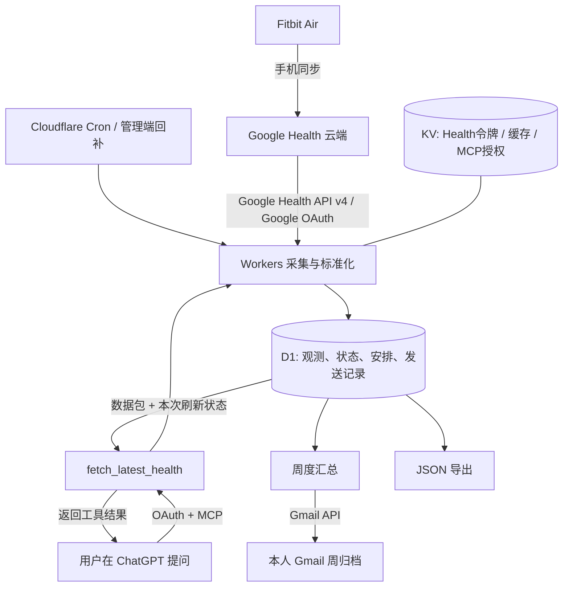

# Personal Health MCP：Google Health → Cloudflare → ChatGPT

> 本项目的大部分设计、代码和搭建文档借鉴自 [JojenJ/fibitair-health-workflow](https://github.com/JojenJ/fibitair-health-workflow)。感谢原作者及其上游项目；保留原始 MIT 许可证和版权声明。本仓库在此基础上记录了个人部署中的改进。

新增内容：睡眠分页缓存与温度采集修复；历史定向回补；静息心率计算方法及 HRV 附加字段；设备最后同步时间（可选授权）；运动会话重叠提醒。详见 [MCP 搭建与改动说明](docs/MCP搭建与改动.md)。

一套可自行部署的个人健康数据工作流：后台安静采集并保存历史；主动提问时，ChatGPT 通过 MCP 当场读取 Google Health；每周可向本人 Gmail 发送数据包。

这个项目记录实际搭建方案和遇到的问题，提供源码、数据库迁移、配置模板、测试及逐步复现指南。每个部署实例服务一位数据所有者，复现者使用自己的设备、Google/Cloudflare 账户和密钥。

## 最终使用方式

- **日常**：手机同步手环后，在已连接 fibitair 的 ChatGPT 项目中询问“先获取最新数据，再看看我最近的睡眠和活动状态”。工具先采集、归档，再返回数据供分析。
- **后台**：默认北京时间 02:15、08:15、14:15、20:15 重采最近 7 天，补齐延迟记录；历史保存到 D1。
- **每周**：可在周一北京时间 09:00 把上一完整周数据及此前 28 天基线发送至本人 Gmail。默认关闭，验收后开启。
- **备用**：从本地管理脚本查询状态、回补、导出 JSON；无需 OpenAI API key，后台不调用 GPT API。

“当场读取”指读取 Google 此刻已有的数据，不能强制手环或手机上传。`refreshSucceeded=true` 也可能伴随成功但为空的指标。缺失、失败、有效天数和数据截至日期都要保留。

## 框架与链路



Google OAuth 授权后台访问健康数据和发送邮件；MCP OAuth 另行授权 ChatGPT 查询。管理令牌、只读令牌和连接密钥各自独立。完整解释见 [方案原理与架构](docs/方案原理与架构.md)。

## 从哪里开始

| 目标 | 文档 |
|---|---|
| 理解方案、选型与数据流 | [方案原理与架构](docs/方案原理与架构.md) |
| 从零搭建并逐步验收 | [从零搭建](docs/从零搭建.md) |
| 查搭建踩坑、原因和修复 | [踩坑与排障](docs/踩坑与排障.md) |
| 看最终效果、证据和边界 | [效果与验收记录](docs/效果与验收记录.md) |
| 连接 ChatGPT、手机日常怎么用 | [日常使用指南](docs/日常使用指南.md) |
| 维护、备份、恢复与撤销授权 | [使用与维护](docs/使用说明.md) |
| 复制项目指令和安排模板 | [项目指令](docs/健康项目指令.txt) · [背景模板](docs/健康背景与安排模板.md) |
| 检查公开范围和安全边界 | [安全说明](SECURITY.md) |

## 复现前提

需要可正常同步至 Google Health 的设备与账户、能启用 Google Health API 的 Google Cloud 项目（Gmail API 仅周邮件需要）、Cloudflare Workers/KV/D1，以及可添加自定义 MCP 插件的 ChatGPT 账户。功能资格、设备产数、地区和平台限制以各账户实际情况为准。无法使用 MCP 时，可先完成归档和 JSON 导出。

建议 **Node.js 24 LTS**；项目最低要求为 22.13（测试使用内置 `node:sqlite`）。锁定 **pnpm 10.30.0**，依赖由 `pnpm-lock.yaml` 固定。

```powershell
git clone https://github.com/lj0014/fibitair-health-workflow.git
cd fibitair-health-workflow
npx --yes pnpm@10.30.0 install --frozen-lockfile
npm run typecheck
npm test
```

后续按 [从零搭建](docs/从零搭建.md) 创建资源、填入自己的 `PUBLIC_ORIGIN`、授权 Google、验证采集，再连接 ChatGPT。不要使用 `legacy:setup:google`；它属于参考实现。

## 数据范围与限制

当前工作流覆盖步数、距离、总消耗与活动能量、睡眠与会话、静息心率、五分钟心率、HRV、呼吸率、SpO₂、夜间相对皮肤温度、活动强度、心率区间、运动场次、久坐及 VO₂ max 等。按小时步数和部分细粒度数据也会归档；具体来源和状态以接口实际返回为准，见 [数据层说明](docs/方案原理与架构.md)。

本项目未提供 Google 官方 Sleep Score、Readiness、Cardio Load 或 Resilience 分数。VO₂ max 在已有验收账户中为空。设备最后同步时间为可选功能，需额外 settings 权限，默认不启用。该方案用于个人观察和复盘。

## 开发与复现检查

```powershell
npm run typecheck
npm test
npm run lint
```

无云检查可以使用假 ID 的独立配置做 Wrangler dry-run 和本地 D1 迁移，详见搭建文档。GitHub Actions 自动执行锁定依赖安装、类型检查、测试、dry-run 和本地迁移；不会部署或发送邮件。线上检查脚本必须显式设置自己的 `HEALTH_WORKER_URL`，不会默认访问原作者部署。

## 目录与来源

`src/workflow/worker.ts` 是本方案入口，`core.ts` 管采集/归档/统计，`live.ts` 与 `mcp.ts` 管即时查询，`oauth.ts` 管 ChatGPT 授权，`gmail.ts` 管周包，`scripts/workflow-setup.ts` 管初始化。`migrations/` 为 D1 迁移，`test/` 为自动化测试。

基于 [Ring8688/google-health-worker-mcp-V1](https://github.com/Ring8688/google-health-worker-mcp-V1)（Google Health provider），上溯至 [tachibanayu24/fitbit-googlehealth-mcp](https://github.com/tachibanayu24/fitbit-googlehealth-mcp)。本方案新增个人归档、Cron、周包、即时 MCP OAuth 查询及可复现文档。

[参考项目原 README](docs/reference-project-README.md) 与 `docs/upstream-*` 为历史资料，其 Claude/Fitbit 入口、旧部署方式和旧测试数量不适用于当前工作流。MIT 许可及上游版权完整保留，见 [LICENSE](LICENSE)。